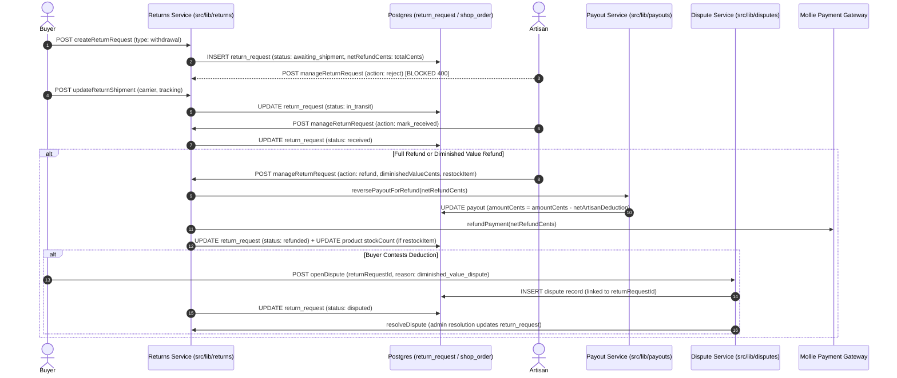

# EU Statutory Returns & Dispute Escalation Hardening

* **Author:** Eurtisan Engineering
* **Status:** Draft
* **Date:** 2026-10-30

--------------------------------------------------------------------------------

## Overview

Eurtisan is an artisan marketplace operating in the European Union. Distance sales to EU consumers are governed by Directive 2011/83/EU (Consumer Rights Directive) and Directive (EU) 2019/771 (Sale of Goods Directive). Under these directives, consumers enjoy an unconditional 14-day statutory right of withdrawal from commercial traders for standard goods, combined with explicit rules governing goods returned in degraded condition (Article 14(2) diminished value).

While Eurtisan has an operational returns subsystem (`src/lib/returns/`), architectural audits revealed six compliance, operational, and financial vulnerabilities:
1. Sellers can unilaterally reject statutory withdrawal requests.
2. No structured flow exists to assess, document, and refund diminished value when items are returned damaged.
3. The platform disburses the buyer refund while leaving the gross seller payout unadjusted, absorbing the refund amount as an unrecovered platform loss.
4. Contested returns and rejected defect claims hit a dead-end status with no path to platform arbitration, while database unique constraints block dispute creation on multi-return orders.
5. Returned damaged items are unconditionally returned to active inventory, risking the resale of broken stock.
6. Return requests lack automated deadline enforcement, allowing abandoned requests to linger in pending states indefinitely.

This design document establishes the architectural and technical specification to resolve these vulnerabilities, ensuring regulatory compliance, protecting artisan and buyer rights, and maintaining platform financial integrity.

--------------------------------------------------------------------------------

## The Problem

1. **Unlawful Seller Rejection of Statutory Withdrawals:**
   In `src/lib/returns/operations.server.ts` (`manageReturnRequestQuery`), sellers can execute `action: 'reject'` unconditionally on any return request as long as a text reason is supplied. Under Article 9 of Directive 2011/83/EU, consumers possess a statutory right to withdraw without cause within 14 days of receipt. A trader has no legal discretion to reject a standard withdrawal request. Providing this control violates consumer protection regulations and exposes the platform to regulatory enforcement.

2. **Absence of Structured Diminished Value Assessment (Article 14(2)):**
   Under Article 14(2), consumers are liable for diminished value resulting from handling beyond what is necessary to establish the nature, characteristics, and functioning of the goods (equivalent to inspecting an item in a physical shop). Currently, sellers can only issue a 100% full refund or refuse the return entirely. Sellers who receive worn, washed, or chipped artisanal goods have no mechanism to document damage, calculate a proportionate deduction, and issue a partial reimbursement, leading to unmediated disputes or uncompensated seller losses.

3. **Pending Payout Platform Financial Leak:**
   In `src/lib/payouts/operations.server.ts` (`reversePayoutForRefund`), when `payout.status === 'pending'`, the function returns `{}` without updating `payout.amountCents`. When `refundReturnRequest` subsequently runs, the platform immediately disburses the refund to the buyer via Mollie. When the scheduled background payout worker later runs `executePayoutQuery`, it transfers 100% of the original gross payout to the seller. The platform disburses the buyer refund while leaving the gross seller payout unadjusted, absorbing the refund amount as an unrecovered platform loss.

4. **Dispute Escalation Dead-End & Unique Constraint Collisions:**
   When a seller rejects a defective item claim (`type: 'defective'`) or when a buyer disputes a condition deduction, the return request remains in a terminal state with no escalation mechanism. Furthermore, `src/db/schema.ts` enforces `uniqueIndex('dispute_shop_order_id_unique')` on `shopOrderId`. If a shop order previously had a delivery inquiry that closed, or if a multi-item order has multiple partial returns over time, attempting to open a dispute crashes with a Postgres unique constraint violation (`23505`). Additionally, `openDisputeQuery` rejects orders not in `delivered` status or orders beyond the 30-day delivery window, blocking disputes on refunded or return-escalated orders.

5. **Reselling Broken Inventory:**
   In `refundReturnRequest`, returned items are unconditionally returned to stock (`product.stockCount + item.quantity`). If an item is returned completely destroyed or unsellable, the system automatically marks it available for sale, selling broken inventory to subsequent buyers.

6. **Unbounded Return Lifecycles & Abandoned Request Accumulation:**
   When a buyer requests a return, `returnDeadline` is set to 14 days. Today, if the buyer never ships the package, the return remains in `awaiting_shipment` indefinitely. Lack of deadline enforcement allows buyers to submit tracking weeks past the statutory window and leaves dormant return records open in perpetuity.

--------------------------------------------------------------------------------

## Goals

* **Enforce Statutory Withdrawal Non-Rejectability:** Prohibit sellers from rejecting return requests where `type === 'withdrawal'` on non-exempt products at the server API boundary.
* **Structured Condition & Value Deductions:** Provide a structured inspection and deduction mechanism under Article 14(2) requiring standardized reason codes, itemized notes, and mandatory photo evidence, while guaranteeing that outbound standard shipping is never penalized.
* **Eliminate Payout Capital Leakage:** Atomically decrement `payout.amountCents` on pending payouts during partial or full refunds, ensuring sellers never receive gross payouts for refunded items.
* **Enable Dispute Escalation for Condition Deductions:** Enable buyers to escalate rejected defective claims and contested condition deductions to platform arbitration without violating existing unique constraints.
* **Selective Restocking Control:** Allow artisans to specify per item whether returned goods are restored to available inventory.
* **Enforce Return Deadlines Deterministically:** Reject tracking submissions past the statutory return deadline (with a carrier grace window) at the action boundary and automatically close abandoned requests through scheduled maintenance.

--------------------------------------------------------------------------------

## Non-Goals

* **Multi-Turn Counter-Offer Negotiation:** The system will not implement iterative negotiation state machines between buyers and sellers. Artisans submit a documented condition assessment with immediate net refund; buyers escalate contested deductions to platform dispute arbitration.
* **Centralized Warehouse Inspections:** Eurtisan will not operate central inspection hubs or act as a physical bailee. Goods travel directly between buyer and seller; the platform arbitrates exclusively through photos and documentation.
* **Universal Payout Freezes:** Payout schedules remain on standard rolling cycles unless an active return, dispute, or chargeback flag exists on that specific shop order.
* **Automated Image/AI Damage Verification:** Damage evidence is reviewed directly by the buyer and human platform administrators.

--------------------------------------------------------------------------------

## Open Questions

*All core architectural questions have been resolved during the review stages:*
* **Evidence Photo Storage:** Reuses the existing image upload pipeline by adding the `'returns'` prefix to `getPresignedUploadUrl` (`src/lib/images/upload.ts`) and `src/lib/images/storage.server.ts`, uploading directly to Scaleway Object Storage.
* **Carrier Handover Grace Buffer:** Set to 72 hours past `returnDeadline` in `updateReturnShipmentQuery` to account for physical carrier drop-offs before system scanning, with daily maintenance closing untracked returns older than 7 calendar days past deadline.

--------------------------------------------------------------------------------

## Critical User Journeys (CUJs)

### CUJ 1: Unconditional Statutory Withdrawal
* **Given**: A buyer received a standard non-customized ceramic bowl 5 days ago.
* **When**: The buyer initiates a return with `type: 'withdrawal'` via `/orders/$platformOrderId/returns/new`.
* **Then**: The return request is created in `status: 'awaiting_shipment'`. The artisan cannot reject the request; attempting to call `manageReturnRequest` with `action: 'reject'` returns HTTP 400 `WITHDRAWAL_CANNOT_BE_REJECTED`.

### CUJ 2: Diminished Value Deduction with Immediate Net Refund
* **Given**: An artisan receives a returned linen shirt that has been washed and stained with wine.
* **When**: The artisan calls `manageReturnRequest` with `action: 'refund'`, providing `diminishedValueCents: 2000`, photo evidence URLs, and category code `worn_washed`.
* **Then**: The system verifies `diminishedValueCents <= refundCents - outboundShippingRefundCents`. The buyer immediately receives `netRefundCents` via Mollie, and the artisan's pending payout is reduced by their net share of the refund. The buyer receives an itemized breakdown with photos and a notification explaining the deduction.

### CUJ 3: Contested Condition Deduction Escalating to Dispute
* **Given**: An artisan assesses a €20 deduction on a returned item, and the buyer receives a partial refund.
* **When**: The buyer inspects the photos, disagrees with the assessment, and clicks "Request Platform Mediation" on `/returns/$returnRequestId`.
* **Then**: The return request transitions to `status: 'disputed'`. The dispute service opens an active dispute record with reason `diminished_value_dispute`, linking `returnRequestId` without violating the partial unique index on open disputes. A platform administrator reviews the evidence and issues a binding resolution.

### CUJ 4: Automatic Expiry of Abandoned Return
* **Given**: A buyer requests a statutory withdrawal, establishing `returnDeadline` 14 days in the future, but never ships the package or enters tracking.
* **When**: 14 days pass plus a 72-hour carrier drop-off grace buffer.
* **Then**: If the buyer attempts to submit tracking via `updateReturnShipment`, the server rejects it with HTTP 409 `RETURN_DEADLINE_EXPIRED`. The daily background maintenance sweep marks the untracked request `status = 'closed'`.

### CUJ 5: Damaged Return Inventory Write-Off (Non-Restocked)
* **Given**: An artisan receives a returned ceramic vase that arrived completely cracked and unsellable.
* **When**: The artisan executes the refund in `ReturnDetailPage.tsx` and unchecks "Restock this item" (`restockItem: false`).
* **Then**: The refund processes, but `refundReturnRequest` filters out the item from stock increments, leaving `product.stockCount` unchanged.

### CUJ 6: Rejected Defective Claim Escalation
* **Given**: A buyer reports an item as defective after 3 months, requesting a seller-funded return.
* **When**: The artisan reviews the report and rejects the claim via `manageReturnRequest(action: 'reject')`, supplying an explanation.
* **Then**: The return request transitions to `status: 'rejected'`. The response and buyer notification provide an explicit `escalateDisputeUrl` allowing the buyer to escalate the rejected defect claim directly to platform dispute arbitration.

--------------------------------------------------------------------------------

## Technical Plan (Architecture)

### System Architecture & Component Interactions

The hardened returns system integrates six core domains without introducing new standalone services:



--------------------------------------------------------------------------------

### Subsystem Specifications

#### 1. Server-Side Statutory Non-Rejectability
* **Location:** `src/lib/returns/operations.server.ts` in `manageReturnRequestQuery`.
* **Mechanism:** When `input.action === 'reject'`, inspect `detail.type`:
  ```ts
  if (input.action === 'reject') {
    if (detail.type === 'withdrawal') {
      response(
        400,
        'WITHDRAWAL_CANNOT_BE_REJECTED',
        'Statutory withdrawal requests for eligible goods cannot be rejected by the seller',
      )
    }
    if (!input.reason) {
      response(400, 'RETURN_REASON_REQUIRED', 'A rejection reason is required')
    }
    await db
      .update(returnRequest)
      .set({ status: 'rejected', rejectionReason: input.reason, updatedAt: new Date() })
      .where(eq(returnRequest.id, detail.id))
  }
  ```
* **Defective Returns Recourse:** For `type: 'defective'`, rejection remains permissible if the artisan disputes the existence of a manufacturing fault. The rejection response payload and buyer notification provide an `escalateDisputeUrl` pointing to `/disputes/new?shopOrderId=${detail.shopOrderId}&returnRequestId=${detail.id}`.

#### 2. Article 14(2) Condition Adjustment & Direct Net Refund
* **Schema Updates (`src/db/schema.ts`):**
  * Extend `returnRequestStatusEnum` with `'disputed'`.
  * Add to `return_request`:
    * `diminishedValueCents: integer('diminished_value_cents').notNull().default(0)`
    * `netRefundCents: integer('net_refund_cents').notNull().default(0)`
    * `diminishedValueReason: text('diminished_value_reason')`
    * `diminishedValueCategory: text('diminished_value_category')`
    * `diminishedValueEvidenceUrls: jsonb('diminished_value_evidence_urls').notNull().default(sql`'[]'::jsonb`)`
* **Condition Category Enum:** Valid categories are `'worn_washed'`, `'scratched_damaged'`, `'missing_packaging'`, `'broken_seal'`, `'structural_damage'`.
* **Bounds & Constraints:**
  * Outbound shipping is legally immune: `diminishedValueCents <= refundCents - outboundShippingRefundCents`.
  * `diminishedValueCents >= 0`.
  * `netRefundCents === refundCents - diminishedValueCents`.
  * `diminishedValueCents` cannot exceed the item value of products flagged `restockItem: false`.
* **Direct Net Refund Execution:** When an artisan inspects returned items, they execute `action: 'refund'`, supplying `diminishedValueCents`, reason code, and evidence URLs. The system calculates `netRefundCents`, disburses the refund immediately via Mollie, and records the itemized breakdown for the buyer.

#### 3. Atomic Pending Payout Reversal Fix
* **Location:** `src/lib/payouts/operations.server.ts` in `reversePayoutForRefund`.
* **Mechanism:**
  ```ts
  if (payoutRecord.status === 'pending') {
    const netArtisanDeduction = Math.round(refundCents * (1 - PLATFORM_FEE_PERCENT / 100))
    const deduction = Math.min(payoutRecord.amountCents, netArtisanDeduction)
    if (deduction >= payoutRecord.amountCents) {
      await tx
        .update(payout)
        .set({
          status: 'reversed',
          reversalReason,
          amountCents: 0,
          reversedAt: new Date(),
        })
        .where(eq(payout.id, payoutRecord.id))
    } else {
      await tx
        .update(payout)
        .set({
          amountCents: payoutRecord.amountCents - deduction,
          reversalReason: `partial_refund:${reversalReason}`,
        })
        .where(eq(payout.id, payoutRecord.id))
    }
    return {}
  }
  ```
* **Payout Lifecycle State Machine:** Update `VALID_PAYOUT_TRANSITIONS` in `src/lib/payouts/lifecycle.ts` to allow `pending: ['in_transit', 'failed', 'reversed']`.
* **Financial Reconciliation Invariant:** Update `src/lib/tax/financial-totals.server.ts` to evaluate expected payout net of partial return reversals.

#### 4. Dispute Bridge Architecture
* **Partial Unique Index:** In `src/db/schema.ts`, replace `uniqueIndex('dispute_shop_order_id_unique')` with:
  ```ts
  uniqueIndex('dispute_active_shop_order_idx').on(table.shopOrderId).where(sql`status = 'open'`)
  ```
* **Dispute Extension:** Add `returnRequestId: uuid('return_request_id').references(() => returnRequest.id, { onDelete: 'set null' })` to table `dispute`.
* **Dispute Lifecycle Resolution Synchronization:** In `resolveDisputeQuery` (`src/lib/disputes/operations.server.ts`), when a dispute linking `returnRequestId` is resolved:
  - If a full or partial refund is awarded, update `return_request.status = 'refunded'`.
  - If the dispute is closed in the seller's favor, update `return_request.status = 'closed'`.
* **Delivery Window Bypass:** In `openDisputeQuery`, bypass `disputeWindowExpiresAt` when a verified `returnRequestId` is linked, allowing return disputes up to 60 days post-order.
* **Order Status Gate:** Allow `openDisputeQuery` when `shopOrder.status` is in `['delivered', 'shipped', 'completed', 'refunded']` if `returnRequestId` is present.

#### 5. Selective Damaged Goods Restocking
* **Schema Update:** Add `restockItem: boolean('restock_item').notNull().default(true)` to `return_request_item`.
* **Execution in `refundReturnRequest`:**
  ```ts
  const items = await tx
    .select({
      productId: orderItem.productId,
      quantity: returnRequestItem.quantity,
      restockItem: returnRequestItem.restockItem,
    })
    .from(returnRequestItem)
    .innerJoin(orderItem, eq(returnRequestItem.orderItemId, orderItem.id))
    .where(eq(returnRequestItem.returnRequestId, id))

  for (const item of items.filter((entry) => entry.restockItem)) {
    await tx
      .update(product)
      .set({ stockCount: sql`${product.stockCount} + ${item.quantity}`, updatedAt: new Date() })
      .where(eq(product.id, item.productId))
  }
  ```

#### 6. Deterministic Return Expiry
* **Action-Time Guard:** In `updateReturnShipmentQuery`, if `now > new Date(returnRequest.returnDeadline.getTime() + 72 * 3600000)`, throw HTTP 409 `RETURN_DEADLINE_EXPIRED`.
* **Lazy Transition on Read:** In `getReturnRequestQuery`, if `status === 'awaiting_shipment'` and `now > new Date(returnDeadline.getTime() + 7 * 86400000)`, lazily update `status = 'closed'`.
* **Scheduled Daily Sweep:** Append an idempotent query to existing daily maintenance jobs:
  ```sql
  UPDATE return_request
  SET status = 'closed', updated_at = NOW()
  WHERE status IN ('requested', 'authorized', 'awaiting_shipment')
    AND return_deadline < NOW() - INTERVAL '7 days';
  ```

--------------------------------------------------------------------------------

## Alternatives Considered

### Alternative A: Retaining Seller Rejection for Statutory Withdrawals with Post-Hoc Admin Auditing
* **Pros**: Allows sellers to manually triage suspected exceptions prior to platform intervention.
* **Cons**: Directly violates Article 9 and Article 10 of EU Directive 2011/83/EU. A consumer's right of withdrawal within 14 days is unconditional for non-exempt goods. Providing a rejection button misleads sellers into believing they have legal discretion to refuse returns on eligible goods, leading to consumer complaints and administrative penalties.
* **Reason for Rejection**: Illegal under European consumer protection law. Sellers can only reject claims where defect liability is contested (`type === 'defective'`).

### Alternative B: Multi-Step Interactive Counter-Offer Negotiation Room
* **Pros**: Allows buyer and artisan to negotiate back and forth over damage percentages before escalating to platform mediation.
* **Cons**: Introduces state machine complexity (`diminished_value_proposed`, `counter_offer_submitted`, `buyer_rejected`, `seller_amended`), high buyer drop-off, indefinite payout and refund holds, and ghosting failure modes.
* **Reason for Rejection**: Rejected due to state machine complexity, increased latency to settlement, and operational overhead. A single documented seller condition assessment backed by photos, paired with immediate net reimbursement and dispute escalation, provides complete legal protection without complex bargaining protocols.

### Alternative C: Mutating Closed Disputes In-Place to Preserve `dispute_shop_order_id_unique`
* **Pros**: Retains the legacy unconditional unique index on `dispute.shopOrderId`.
* **Cons**: Overwriting `resolution: null`, `reason`, and `returnRequestId` on a resolved dispute erases the historical audit trail and financial resolution history of prior disputes on that order.
* **Reason for Rejection**: High systemic coupling. Reusing existing dispute records preserves the 1:1 shop order invariant without altering downstream payout or lifecycle queries. Replacing the unique index with a partial unique index on open disputes (`WHERE status = 'open'`) maintains the single active dispute rule cleanly.

### Alternative D: Dedicated Continuous Return Expiration Daemon
* **Pros**: Immediately transitions abandoned return requests to `closed` the moment the 14-day window expires.
* **Cons**: Unshipped return requests hold neither inventory reservations nor customer funds. Running a dedicated continuous background worker service adds process monitoring, resource overhead, and periodic database load without operational necessity.
* **Reason for Rejection**: Action-time rejection, lazy evaluation on read, and existing daily batch sweeps achieve compliance within existing infrastructure.

### Alternative E: Centralized Platform Physical Warehouse Inspection
* **Pros**: Platform staff physically examine returned goods and certify damage before authorizing any diminished value deduction.
* **Cons**: Significant logistics overhead, cross-border customs friction, multi-week shipping delays, and warehouse lease costs incompatible with direct maker-to-buyer marketplace economics.
* **Reason for Rejection**: Prohibitive infrastructure and operational costs. Direct peer-to-peer shipping with documentary and photographic arbitration scales sustainably.

### Alternative F: Universal Payout Hold During Statutory 14-Day Withdrawal Window
* **Pros**: Completely eliminates platform capital leakage and negative seller balance clawback risks by holding all seller funds until the return window expires.
* **Cons**: Severely damages artisan cash flow, introduces significant seller friction and onboarding churn, and places Eurtisan at a competitive disadvantage against peer artisan platforms.
* **Reason for Rejection**: Disproportionate blast radius on seller liquidity; atomic pending payout decrements combined with platform negative balance accounting protect financial integrity without penalizing compliant artisans.

--------------------------------------------------------------------------------

## Non-Functional Requirements

### Security & Privacy
* **Evidence Photo Access Control:** Uploaded damage evidence photos must be stored in private object storage and served through signed or authenticated URLs to prevent unauthorized public access to buyer or seller premises.
* **Privileged Mutation Guard:** Seller return management actions (`manageReturnRequest`) require active authentication with role `creator` or `admin` and must enforce privileged two-factor authentication (`requirePrivileged2FA`) independently of route guards. Buyer return actions use separate buyer access guards.

### Financial Integrity & Idempotency
* **Deduction Bounds Check:** Database check constraints and server Zod schemas must enforce that `diminished_value_cents` cannot exceed `refund_cents - outbound_shipping_refund_cents`. Outbound standard shipping cannot be diminished under any condition.
* **Atomic Payout Sync:** `reversePayoutForRefund` must atomically update pending payouts within the database transaction to prevent race conditions with the scheduled payout executor.

### Observability & Auditability
* **Immutable Audit Trail:** All return actions (`return.create`, `return.shipment_update`, `return.propose_condition_adjustment`, `return.dispute_escalate`, `return.refund`) must emit structured audit events to the `audit_log` table with user identifiers, timestamps, and payload metadata.

--------------------------------------------------------------------------------

## Risks & Mitigations

### 1. Negative Seller Balance on Sent Payout Clawbacks
* **Risk:** If a return occurs after payout has already been sent to the artisan (`payout.status === 'sent'`), and Mollie routing reversal fails due to zero balance in the artisan's connected account, the platform must still fulfill the statutory refund to the buyer.
* **Mitigation:** Decouple the statutory refund from the seller clawback. Disburse the buyer refund unconditionally via Mollie platform balance, record a persistent negative balance against `shop.payoutBalanceCents`, and automatically offset the balance against future order payouts.

### 2. Postal Transit Race Conditions
* **Risk:** A buyer hands the package to a postal carrier on day 14, but carrier tracking is only entered into the system on day 16, resulting in action-time rejection.
* **Mitigation:** The action-time guard in `updateReturnShipmentQuery` includes a 72-hour grace window past `returnDeadline`. If tracking entry is attempted within the grace window, it is accepted and sets `status = 'in_transit'`.

### 3. Database Deadlock Hazards between Returns and Disputes
* **Risk:** Concurrent execution of `refundReturnRequest` and `openDisputeQuery` could invert row lock acquisition between `shop_order` and `return_request`, causing PostgreSQL transaction deadlocks (`40P01`).
* **Mitigation:** Enforce a strict global lock hierarchy across all related server operations: always acquire the row lock on `shop_order` first, followed by `return_request`, and finally `dispute`.

--------------------------------------------------------------------------------

## Detailed Implementation Plan

### Implementation Worklist

1. **Database Schema & Migrations:**
   * Modify `src/db/schema.ts` to extend `returnRequestStatusEnum` with `'disputed'`.
   * Add diminished value and net refund fields to `returnRequest`, add `restockItem` to `returnRequestItem`, add `returnRequestId` to `dispute`, and replace `dispute_shop_order_id_unique` with `dispute_active_shop_order_idx` partial unique index on open disputes.
   * Run `make db-generate` to create the incremental Drizzle migration in `drizzle/` with backfill logic for existing records (`net_refund_cents = refund_cents`).

2. **Domain Rules & Financial Boundaries:**
   * Update `src/lib/returns/rules.ts` with pure calculation functions for condition deductions, enforcing outbound standard shipping immunity.
   * Update `src/lib/returns/types.ts` and `src/lib/returns/schemas.ts` with the new actions, reason codes, and deduction schemas.

3. **Payout Atomic Decrement & Lifecycle Updates:**
   * Modify `src/lib/payouts/lifecycle.ts` to allow `pending -> reversed`.
   * Modify `src/lib/payouts/operations.server.ts` in `reversePayoutForRefund` to atomically decrement `payout.amountCents` by net artisan proceeds.

4. **Return Operations & State Transitions:**
   * Modify `src/lib/returns/operations.server.ts`:
     * Prevent `action: 'reject'` when `detail.type === 'withdrawal'`.
     * Update `createReturnRequestQuery` to initialize `netRefundCents: refund.totalCents`.
     * Update `refundReturnRequest` to consume `netRefundCents` and selectively restock items where `restockItem === true`.
     * Enforce action-time deadline guard (with 72h grace buffer) in `updateReturnShipmentQuery`.
     * Add lazy status expiration on read in `getReturnRequestQuery`.

5. **Dispute Integration Bridge & Resolution Synchronization:**
   * Modify `src/lib/shop-orders/lifecycle.ts` to allow `completed -> disputed` and `refunded -> disputed`.
   * Modify `src/lib/disputes/schemas.ts` and `src/lib/disputes/operations.server.ts`:
     * Add `returnRequestId` to dispute inputs and database records.
     * In `openDisputeQuery`, allow orders in `['delivered', 'shipped', 'completed', 'refunded']` and bypass the 30-day delivery window if linked to a return.
     * In `resolveDisputeQuery`, update linked `return_request.status` to `'refunded'` or `'closed'` upon resolution.

6. **Image Upload Infrastructure:**
   * Update `src/lib/images/upload.ts` and `src/lib/images/storage.server.ts` to include `'returns'` in allowed upload prefixes.

7. **User Interface Surfaces:**
   * Update `src/components/ReturnDetailPage.tsx`:
     * Remove the reject button for statutory withdrawals.
     * Add condition assessment inputs, photo upload triggers, and restocking checkboxes for artisans.
     * Display itemized deduction details and "Request Platform Mediation" button for buyers.
   * Update `src/route-components/studio/$shopId.orders.$shopOrderId.tsx` to render updated return status badges.

8. **Testing & Verification:**
   * Colocate and update unit and integration test suites covering all changed pathways.

---

### Target Files to Create/Modify

#### 1. `src/db/schema.ts` (Modify)
* **Type / Scope:** Drizzle ORM Schema Definitions
* **Rationale:** Add `'disputed'` to `returnRequestStatusEnum`, add `diminishedValueCents`, `netRefundCents`, `diminishedValueReason`, `diminishedValueCategory`, `diminishedValueEvidenceUrls` to `returnRequest`, add `restockItem` to `returnRequestItem`, add `returnRequestId` foreign key to `dispute`, and replace `dispute_shop_order_id_unique` with partial unique index `WHERE status = 'open'`.

#### 2. `drizzle/` (Create Migration)
* **Type / Scope:** PostgreSQL Migration SQL & Metadata
* **Rationale:** Generated via `make db-generate` to apply schema changes to PostgreSQL, including a data migration script backfilling `net_refund_cents = refund_cents` on legacy rows and creating table check constraints.

#### 3. `src/lib/returns/types.ts` (Modify)
* **Type / Scope:** TypeScript Domain Types
* **Rationale:** Expand `ReturnRequestStatus` union with `'disputed'`, and add diminished value fields and item restocking flags to `ReturnRequestSummary`.

#### 4. `src/lib/returns/schemas.ts` (Modify)
* **Type / Scope:** Zod RPC Validation Schemas
* **Rationale:** Extend `manageReturnRequestSchema` to accept condition category enums, deduction cents, photo evidence URLs, and itemized restocking flags.

#### 5. `src/lib/returns/rules.ts` (Modify)
* **Type / Scope:** Pure Domain Calculation Logic
* **Rationale:** Add pure helper `calculateConditionDeduction(refundCents: number, outboundShippingRefundCents: number, requestedDeductionCents: number): number` enforcing outbound shipping immunity, and `isReturnExpired(returnDeadline: Date, now?: Date, graceHours?: number): boolean`.

#### 6. `src/lib/returns/rules.test.ts` (Modify)
* **Type / Scope:** Pure Unit Test Suite
* **Rationale:** Add unit test coverage proving outbound shipping protection, deduction bounds calculation, and deadline expiry calculations with 72h grace.

#### 7. `src/lib/payouts/lifecycle.ts` (Modify)
* **Type / Scope:** Payout State Machine
* **Rationale:** Update `VALID_PAYOUT_TRANSITIONS` to allow `pending: ['in_transit', 'failed', 'reversed']`.

#### 8. `src/lib/payouts/operations.server.ts` (Modify)
* **Type / Scope:** Server-Only Payout Operations
* **Rationale:** Modify `reversePayoutForRefund` so when `payout.status === 'pending'`, it atomically decrements `payout.amountCents` by net artisan proceeds (or transitions status to `'reversed'` with `reversedAt: new Date()`), eliminating platform capital leakage.

#### 9. `src/lib/payouts.server.test.ts` (Modify)
* **Type / Scope:** Database Integration Test Suite
* **Rationale:** Add tests verifying that issuing a partial return refund against a pending payout atomically decrements the payout record and prevents overpayment when `executePayoutQuery` executes.

#### 10. `src/lib/returns/operations.server.ts` (Modify)
* **Type / Scope:** Server-Only Return Operations
* **Rationale:** Enforce withdrawal non-rejectability in `manageReturnRequestQuery`, initialize `netRefundCents: refund.totalCents` in `createReturnRequestQuery`, process net refunds and filter restocking by `restockItem` in `refundReturnRequest`, and add action-time deadline guards.

#### 11. `src/lib/returns/operations.server.test.ts` (Modify)
* **Type / Scope:** Database Integration Test Suite
* **Rationale:** Add test cases proving: (a) statutory withdrawal cannot be rejected (throws 400), (b) condition deductions execute partial refunds and credit notes, (c) selective restocking only increments stock for marked items, and (d) tracking submission after deadline + 72h grace throws 409.

#### 12. `src/lib/shop-orders/lifecycle.ts` (Modify)
* **Type / Scope:** Shop Order State Machine
* **Rationale:** Update `VALID_TRANSITIONS` to allow `completed -> disputed` and `refunded -> disputed` when linked to returns.

#### 13. `src/lib/disputes/schemas.ts` (Modify)
* **Type / Scope:** Zod Dispute Validation Schemas
* **Rationale:** Add optional `returnRequestId` parameter and new dispute reason codes (`'return_rejection'`, `'diminished_value_dispute'`).

#### 14. `src/lib/disputes/operations.server.ts` (Modify)
* **Type / Scope:** Server-Only Dispute Operations
* **Rationale:** Handle return escalation in `openDisputeQuery`, relax order status gate and 30-day window for returns, and update `resolveDisputeQuery` to synchronize return request status to `'refunded'` or `'closed'`.

#### 15. `src/lib/disputes.test.ts` (Modify)
* **Type / Scope:** Database Integration Test Suite
* **Rationale:** Verify dispute creation from a contested return when an order is in `refunded` status, and prove dispute resolution synchronizes the return request status.

#### 16. `src/lib/images/upload.ts` & `src/lib/images/storage.server.ts` (Modify)
* **Type / Scope:** Image Upload Pipeline
* **Rationale:** Add `'returns'` to allowed upload key prefixes.

#### 17. `src/components/ReturnDetailPage.tsx` (Modify)
* **Type / Scope:** Return Detail Component
* **Rationale:** Remove reject button for withdrawal returns, add condition assessment inputs, photo uploads, per-item restock checkboxes, and buyer dispute escalation button.

#### 18. `src/route-components/studio/$shopId.orders.$shopOrderId.tsx` (Modify)
* **Type / Scope:** Studio Order Component
* **Rationale:** Display updated return status badges.

---

### Verification Plan

* **Type Check & Linting:**
  * Run `make check` to verify TypeScript contracts across returns, payouts, disputes, and UI components.
  * Run `make lint` and `make format` to verify style and formatting compliance.
* **Unit & Integration Tests:**
  * Run `make test src/lib/returns` to verify pure rules and database return operations.
  * Run `make test src/lib/payouts` to verify atomic pending payout decrements.
  * Run `make test src/lib/disputes` to verify dispute bridge escalation and resolution synchronization.
* **Database Schema Check:**
  * Run `make db-check` and `make db-migrate-fresh` to verify migration application and rollback cleanliness.
